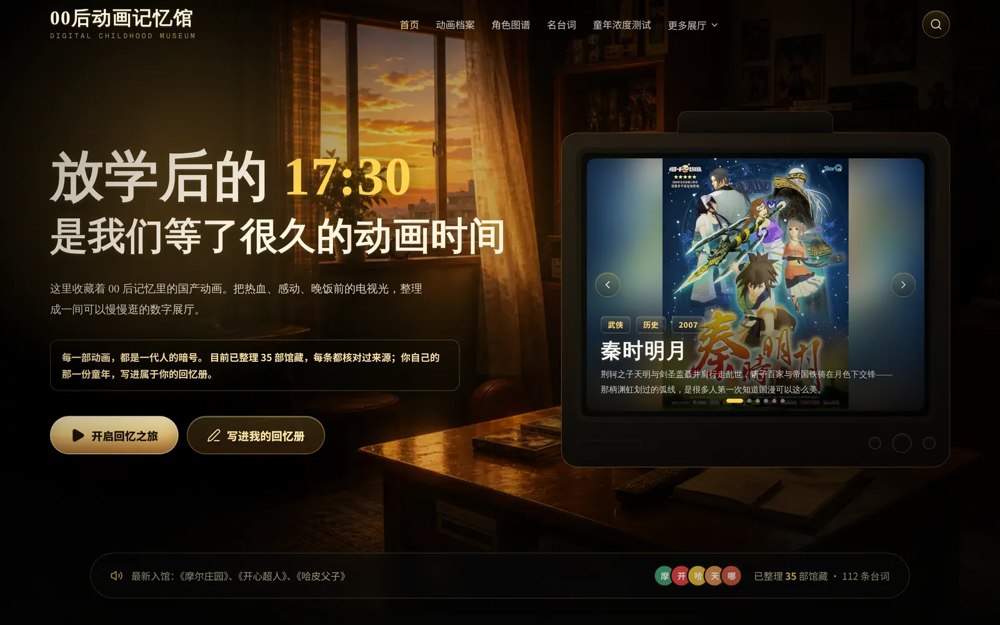
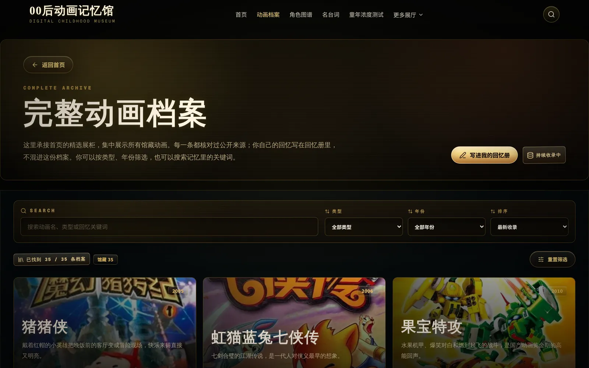
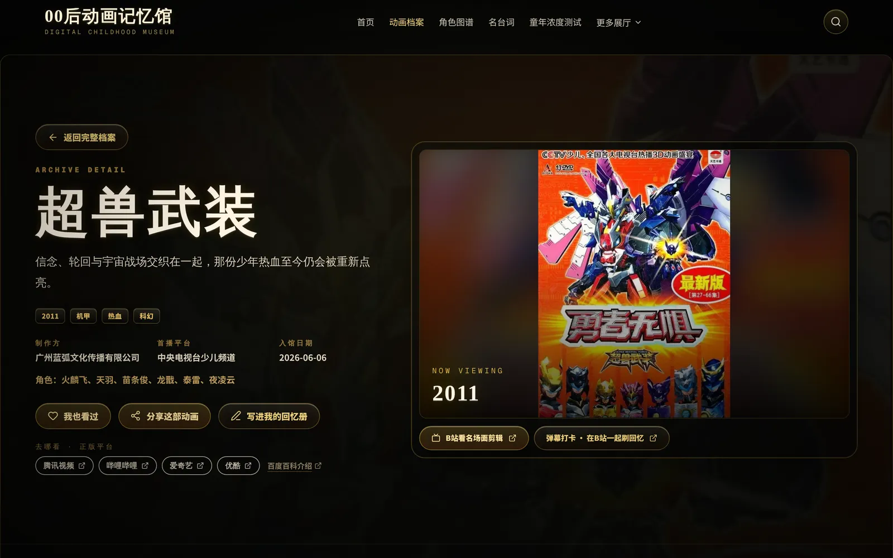
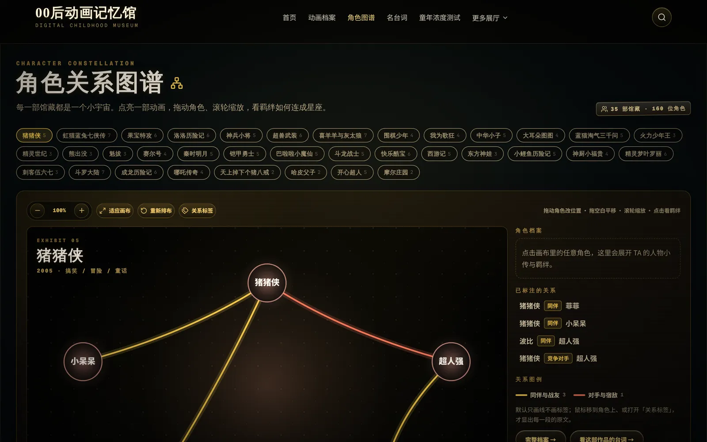
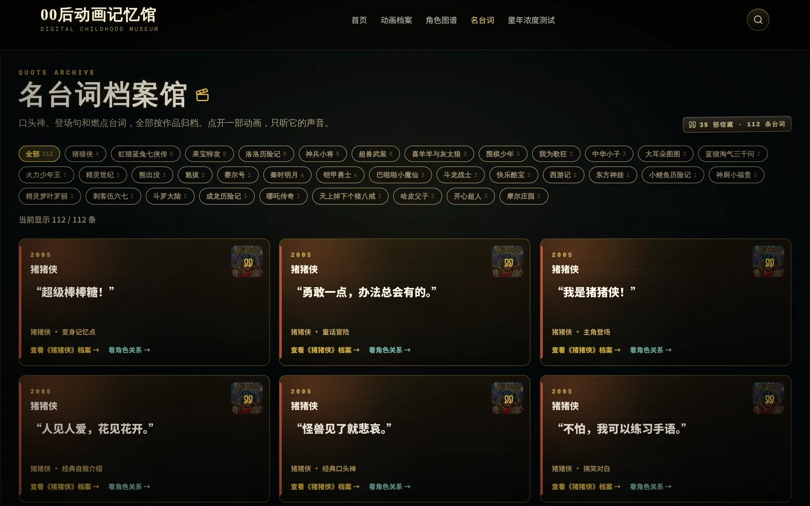
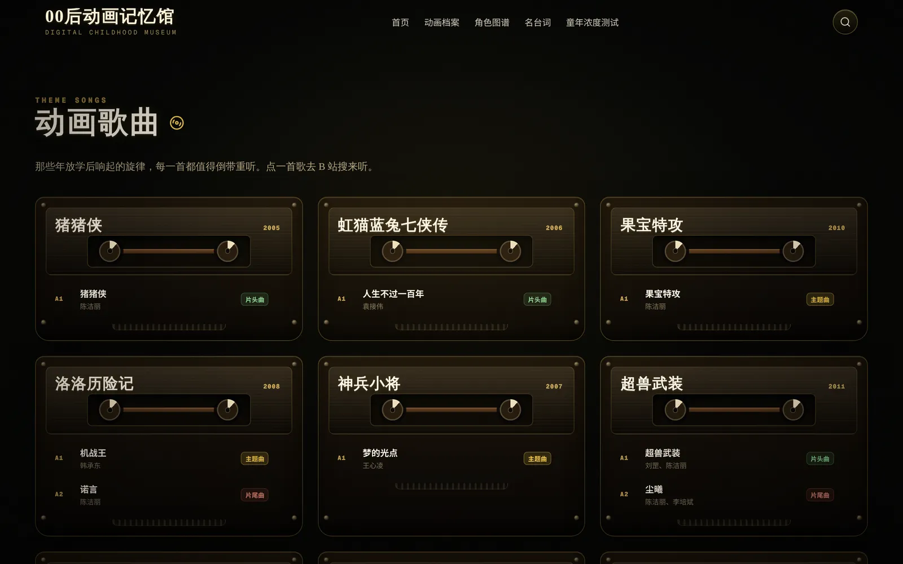
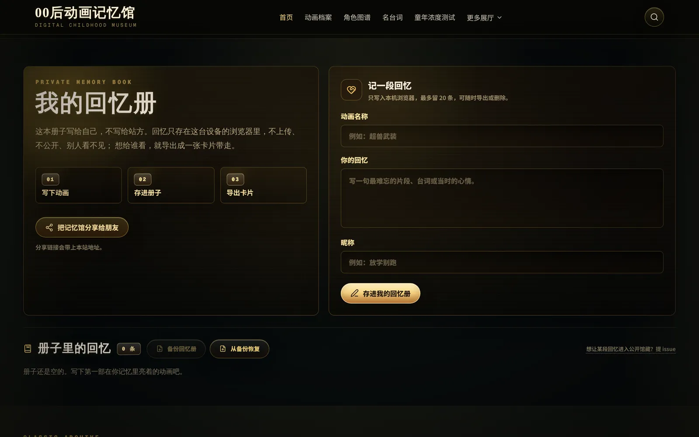
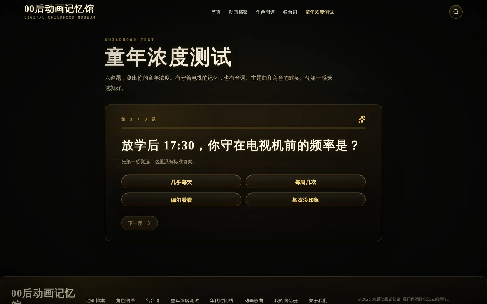
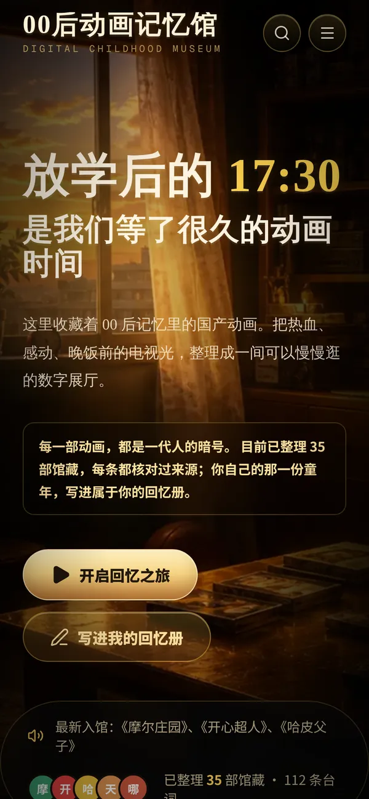
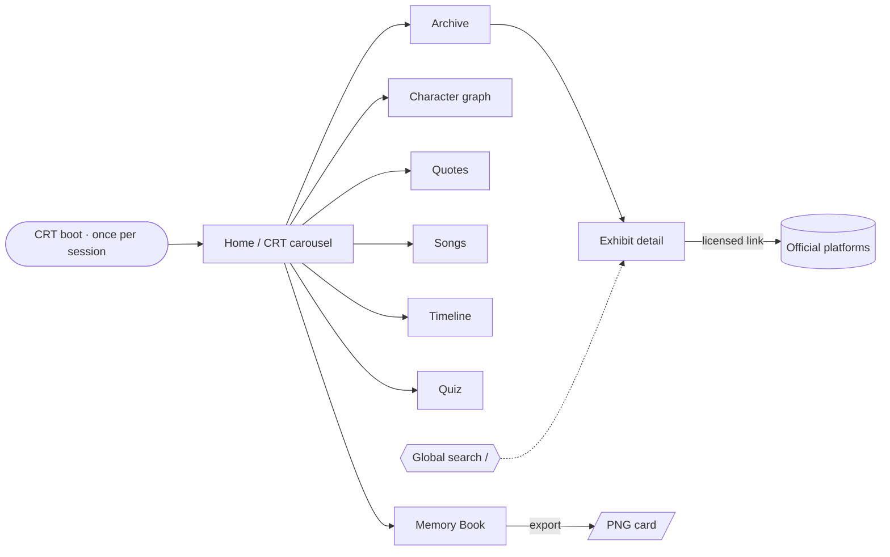

<div align="center">

# Digital Childhood Museum

**A digital museum for Chinese childhood animation memories — the cartoons that aired at 17:30, after school.**

[简体中文](./README.md) | [English](./README.en.md)

[](https://museum.seanwalter.top)
[](https://nextjs.org)
[](https://react.dev)
[](./LICENSE)
[](https://github.com/Dream22180971/animation-memory-museum/actions/workflows/ci.yml)



**[Visit the museum →](https://museum.seanwalter.top)** · [Quick Start](#-quick-start)

</div>

---

## 🎯 What it is

`00后动画记忆馆` is a nostalgic web exhibition of the Chinese TV animation that a generation grew up with — 猪猪侠, 虹猫蓝兔七侠传, 超兽武装, 秦时明月 and more.

It is **not a streaming site**. It hosts no video or audio. Instead it curates what surrounds the screen: posters, characters, catchphrases, theme songs, the year a show first aired — and a private notebook for your own memories. Every "watch" button sends you to a licensed platform.

> The site UI is in Simplified Chinese. This is the English README; the Chinese one is the default.

## 📺 Tonight's Program Guide

The museum is laid out like a channel lineup. Every row is a real route in `src/app/`.

| Channel | Route | What's on |
|---|---|---|
| **CH 01** · Home | `/` | CRT TV carousel of 6 core titles, film strip, previews of every hall |
| **CH 02** · Archive | `/archive` | All admitted titles with keyword search, genre / year filters and sorting |
| **CH 03** · Exhibit | `/archive/[slug]` | Poster, studio, broadcaster, characters, licensed watch links, share & "I watched it too" |
| **CH 04** · Characters | `/characters` | Interactive relationship graph — drag, pan, zoom, click a character for a profile |
| **CH 05** · Quotes | `/quotes` | Catchphrases and battle cries, filterable by title |
| **CH 06** · Songs | `/songs` | Openings and endings styled as cassettes, each a link to search it on Bilibili |
| **CH 07** · Timeline | `/timeline` | Titles grouped into 4-year eras counted from the earliest admitted year |
| **CH 08** · Quiz | `/quiz` | Six-question "childhood concentration" test; the result can be saved as an image card |
| **CH 09** · Memory Book | `/#contribute` | Private notebook saved in your browser, exportable as PNG cards, with backup and restore |
| **CH 10** · About | `/about` | Project story, copyright notice and credits |

On desktop, the "更多展厅" (more halls) menu in the navbar reaches the timeline, songs, Memory Book and About pages. A global search (press <kbd>/</kbd>) covers titles, songs, singers and genres from any page.

## 🎬 Screenshots

All captured from a local production build with [`scripts/capture-screenshots.mjs`](./scripts/capture-screenshots.mjs).

<table>
  <tr>
    <td width="50%"><br /><sub><b>Archive</b> — search, filter and sort the collection</sub></td>
    <td width="50%"><br /><sub><b>Exhibit</b> — metadata, characters and licensed watch links</sub></td>
  </tr>
  <tr>
    <td><br /><sub><b>Character graph</b> — draggable, zoomable relationships</sub></td>
    <td><br /><sub><b>Quotes</b> — catchphrases archived per title</sub></td>
  </tr>
  <tr>
    <td><br /><sub><b>Songs</b> — openings and endings as cassettes</sub></td>
    <td><br /><sub><b>Memory Book</b> — local-only notes, exported as image cards</sub></td>
  </tr>
  <tr>
    <td><br /><sub><b>Quiz</b> — six questions, one shareable verdict</sub></td>
    <td align="center"><br /><sub><b>Mobile</b> — the same evening, on a phone</sub></td>
  </tr>
</table>

## ✨ Features

| Area | What you get |
|---|---|
| CRT boot ritual | A once-per-session TV power-on intro on the home page; skipped when the OS asks for reduced motion |
| Curated collection | 35 titles (1999–2018), 160 characters, 155 character relations, 112 quotes, 42 songs |
| Licensed watch links | 127 outbound links that open each title's search page on official platforms (Tencent Video, Bilibili, iQIYI, Youku, CCTV, Xigua) — nothing is played on-site |
| Character graph | Per-title relationship graph with drag, pan, zoom, relation labels and character profiles |
| Memory Book | Write memories in your own browser (the latest 20 are kept); export any of them as a canvas-drawn PNG card; back the whole book up to JSON and restore it on another device (duplicates are skipped) |
| Quiz result card | Turn your quiz result into a 1200×630 image card: native share sheet on phones, download on desktop |
| "I watched it too" | One-click mark on each exhibit, remembered locally |
| Share previews | Every hall has its own share title and preview image (captured from the real page); exhibit pages use the title's poster |
| Share | Native share sheet where supported, clipboard fallback elsewhere |
| Motion system | Motion tokens and rituals documented in [`Museum-Motion-Design-System-v1.0.md`](./Museum-Motion-Design-System-v1.0.md) |

## 🧭 Experience Map



## 🔐 Privacy & Content Boundary

- **Your memories stay on your device.** Memory Book entries and "watched" marks live in `localStorage`; they are never uploaded, and backups are downloaded only to your own device. Want a memory admitted to the public archive? Open an [issue](https://github.com/Dream22180971/animation-memory-museum/issues).
- **The deployed site uses Vercel Web Analytics** (`@vercel/analytics`) for page-view statistics.
- **No video or audio is hosted.** Watch buttons and song links leave the site for licensed platforms or a Bilibili search.
- **Sources are cited.** Facts reference public sources such as Baidu Baike (linked per title); posters come from community databases such as [Bangumi](https://bgm.tv), recorded in [`scripts/poster-credits.json`](./scripts/poster-credits.json). All rights belong to the original creators — rights holders can request removal via GitHub Issues, as stated on `/about`.

## 🔎 Search & AI Discoverability

The site exposes these entry points for search engines and AI search. All of them are generated from `animations.json`, so new titles need no manual upkeep:

| Entry point | Content |
|---|---|
| [`/sitemap.xml`](https://museum.seanwalter.top/sitemap.xml) | Home, the 7 halls and every exhibit page |
| [`/robots.txt`](https://museum.seanwalter.top/robots.txt) | Allows all crawlers and explicitly lists AI crawlers such as GPTBot, ClaudeBot and PerplexityBot |
| [`/llms.txt`](https://museum.seanwalter.top/llms.txt) | A site guide for AI tools: the halls plus each title's year, studio, broadcaster, genres and characters |
| JSON-LD structured data | `WebSite` on the home page, an `ItemList` on the archive, a `TVSeries` per title (characters, studio, Baidu Baike link) and breadcrumbs |
| Page metadata | Per-page title, description, canonical URL and share image |

Every page is prerendered at build time, so quotes, characters and songs are in the HTML itself and readable by crawlers that don't run JavaScript.

**One step only the site owner can do:** verify ownership on each platform and submit the sitemap. Verification tags are already wired up; set the matching variable in the deployment environment (e.g. Vercel) and redeploy:

| Platform | Environment variable | Tag emitted |
|---|---|---|
| Google Search Console | `GOOGLE_SITE_VERIFICATION` | `google-site-verification` |
| Bing Webmaster Tools | `BING_SITE_VERIFICATION` | `msvalidate.01` |
| Baidu Search Resource Platform | `BAIDU_SITE_VERIFICATION` | `baidu-site-verification` |

Unset variables emit nothing.

## ⚡ Quick Start

Requires **Node.js 22** (the version CI uses) and npm.

```bash
git clone https://github.com/Dream22180971/animation-memory-museum.git
cd animation-memory-museum

npm install
npm run dev
```

Open `http://localhost:3000`.

## 🛠 Commands

| Command | What it does |
|---|---|
| `npm run dev` | Start the dev server |
| `npm run validate:data` | Validate `src/data/animations.json` against the schema rules in `scripts/validate-data.mjs` |
| `npm run typecheck` | `tsc --noEmit` |
| `npm run lint` | ESLint |
| `npm run build` | Runs `validate:data` first (`prebuild`), then `next build --webpack` |
| `npm start` | Serve the production build |
| `npm run test:e2e` | Playwright end-to-end tests |
| `node scripts/capture-screenshots.mjs` | Regenerate `docs/screenshots/` from a running server (`BASE_URL`, default `http://localhost:3000`) |
| `node scripts/capture-og-images.mjs` | Re-capture each hall's share image `src/app/**/opengraph-image.jpg` from a running server; rebuild afterwards |

The production build intentionally uses webpack (`next build --webpack`). Keep it that way unless bundle behavior has been re-tested.

## 🧪 Testing

`tests/e2e/museum.spec.ts` covers home stats and global search, archive filters, the Memory Book (save, export entry, delete, backup and restore, kept out of the public archive), "I watched it too", the quiz and its result card, exhibit metadata and licensed links, the character graph (switching titles, opening profiles, drag and zoom), and the sitemap, robots, `llms.txt`, structured data and share metadata.

- Playwright starts its own dev server on `127.0.0.1:3100` and runs a **desktop Chrome** and a **Pixel 5** project.
- Locally the projects use your installed Google Chrome (`channel: "chrome"`); with `CI` set they use Playwright's bundled Chromium (`npx playwright install chromium`).
- [CI](./.github/workflows/ci.yml) runs lint → data validation → typecheck → build → E2E on every pull request and on pushes to `main`.

## 🗂 Project Structure

```text
src/
├── app/                 # routes: /, archive, archive/[slug], characters, quotes, songs, timeline, quiz, about,
│                        # plus sitemap.ts, robots.ts, llms.txt/ and each hall's opengraph-image.jpg
├── components/          # hero (CRT, boot intro, film strip), archive, characters, quotes, songs, timeline,
│                        # quiz, search, engagement (Memory Book), motion, layout, ui
├── data/animations.json # the whole collection — single source of truth
└── lib/                 # data helpers, quiz logic, site constants (HERO_FEATURED_SLUGS …), page metadata,
                         # structured data, share-card drawing, Memory Book backup
scripts/                 # data validation, poster fetching/optimization, screenshots
tests/e2e/               # Playwright specs
public/images/           # posters, scene and memory artwork
```

### Adding a title

1. Add an entry to `src/data/animations.json` (every field listed in `scripts/validate-data.mjs` is required).
2. Run `npm run validate:data`.
3. To put it on the home-page TV, add its slug to `HERO_FEATURED_SLUGS` in `src/lib/constants.ts` — new titles don't join the carousel automatically.

## ⚠️ Current Limitations

- The interface is Chinese-only.
- The collection is hand-curated: 35 titles from 1999 to 2018, mainland Chinese TV animation only.
- Memory Book is per-browser: no accounts and no automatic sync, only the latest 20 entries are kept; use "备份回忆册" (back up) before clearing site data.
- No playback by design — the museum only points to licensed platforms.

## 🗺 Roadmap

- [x] CRT home experience and boot ritual
- [x] Archive, exhibit pages and global search
- [x] Character relationship graph
- [x] Quotes, songs and era timeline
- [x] Childhood quiz
- [x] Local Memory Book with image-card export
- [ ] More titles and animation categories
- [ ] Childhood TV dramas, Flash games and old-web memories
- [ ] AI-assisted nostalgia interactions

## 🤝 Contributing

Suggestions for titles, corrections and memories worth archiving are welcome through [GitHub Issues](https://github.com/Dream22180971/animation-memory-museum/issues). For code changes, run `npm run lint`, `npm run typecheck` and `npm run build` before opening a pull request.

## 📄 License

Code is released under the [MIT License](./LICENSE). Animation names, posters, characters, quotes and songs remain the property of their original creators.

<div align="center">

**Not a streaming site. A place for the memories around the screen.**

</div>
